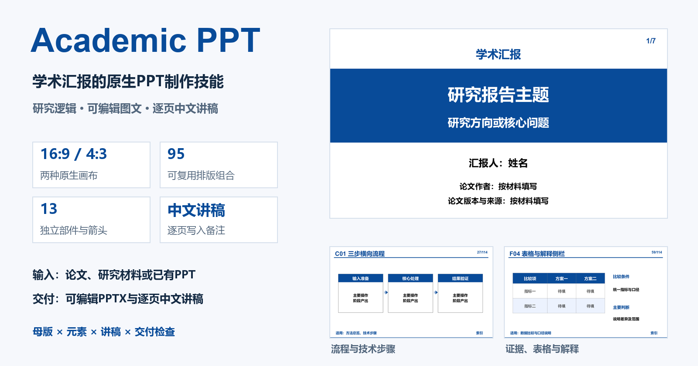
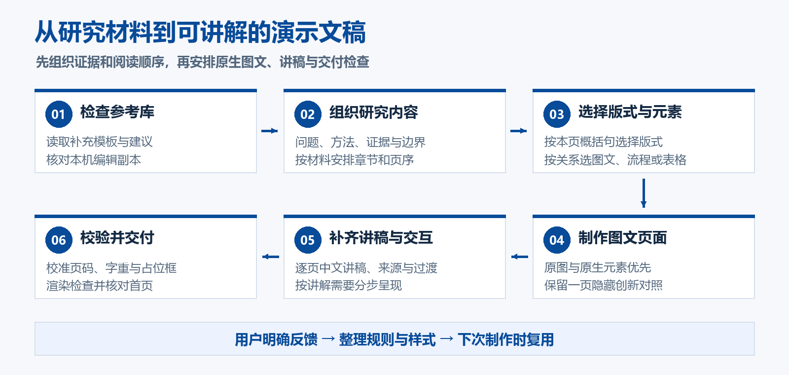
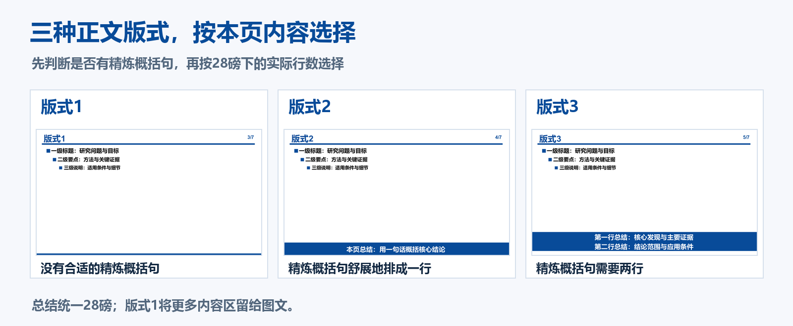
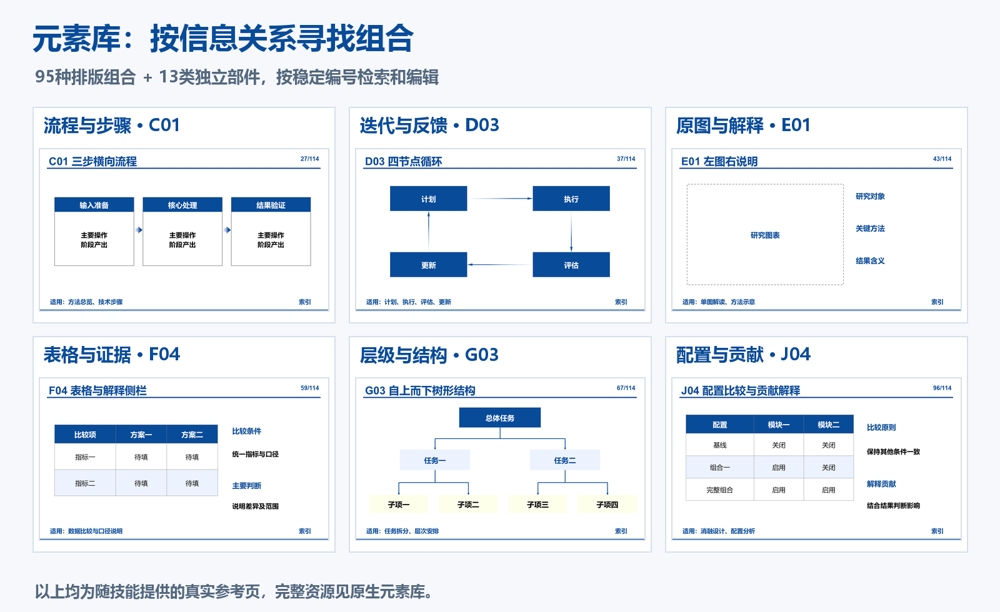
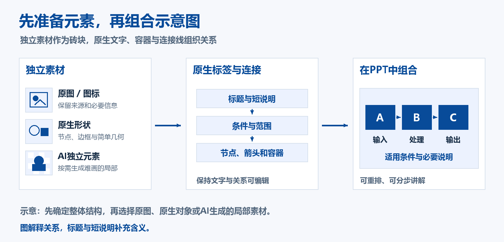
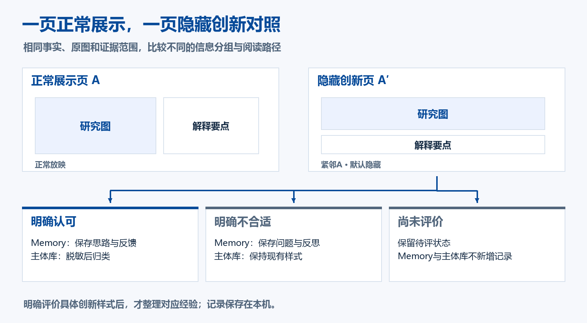

# Academic PPT

**把研究材料组织成逻辑清楚、图文易读、能够继续编辑的学术演示文稿。**

<p align="center">
  <a href="LICENSE"></a>
  &nbsp;
  <a href="SKILL.md"></a>
  &nbsp;
  <a href="assets/reference.pptx"></a>
</p>

Academic PPT 是一个面向 Codex 的学术 PPT 制作与修订技能，适用于论文汇报、研究组会、开题报告和学位答辩。它将研究内容的组织方法、原生 PowerPoint 母版、可编辑元素库、逐页中文讲稿及交付检查放在同一套工作流程中。

你提供论文、研究材料或已有 PPT，并说明听众、时长和要求；Codex 按本技能组织研究问题、方法、证据与结论，选择合适的版式和图文表达，完成演示文稿及讲稿。



[安装与更新](#安装与更新) · [快速上手](#快速上手) · [制作流程](#制作流程) · [设计规范](#设计规范) · [模板与元素库](#模板与元素库) · [辅助脚本](#辅助脚本) · [贡献与许可](#贡献与许可)

## 能做什么

| 能力 | 具体做法 | 对汇报的帮助 |
| --- | --- | --- |
| 研究内容组织 | 围绕问题、方法、证据、结论及其适用范围安排章节 | 让观众知道研究为什么做、怎样做、证据说明了什么 |
| 原生模板排版 | 提供 16:9 和 4:3 母版、目录及三种正文版式 | 在统一风格下，按每页内容安排版面 |
| 可编辑元素组合 | 95 种排版组合、13 类独立部件，按 A—K 分类检索 | 快速搭建流程、比较、结构、结果和图文页面 |
| 图示与结构化文字 | 原图、原生形状、图标和独立素材按关系组合 | 用图解释关系，用小标题和短说明补充含义 |
| 逐页中文讲稿 | 在备注中写阅读顺序、关键数字、证据边界、过渡与出处 | 页面简洁，同时保留讲解所需的细节 |
| 必要的动画与交互 | 按讲解需要分步呈现、突出关系或设置跳转 | 帮助观众跟随复杂图示的阅读顺序 |
| 隐藏创新对照 | 每份新制作或重新制作的 PPT 额外保留 1 页隐藏创新版本 | 用同一份内容比较不同排布，再根据反馈维护经验 |
| 交付整理与检查 | 校准页码、默认字重、无用占位框及打开视图，再检查渲染结果 | 降低交付前重复整理页面的工作量 |

标题、正文、原生形状、连接线和原生表格可以继续在 PowerPoint 中修改。嵌入的论文原图仍以图片保存；AI 生成的独立素材也作为图片对象使用，周围的标签、箭头和结构可分别编辑。

## 安装与更新

### 方式一：把仓库链接发给Codex，让它安装

这是最方便的方式。打开 Codex，将下面这段话直接粘贴到对话中：

```text
请帮我安装 Academic PPT 技能：
https://github.com/realihang/academic-ppt-skill

仓库根目录就是技能目录，SKILL.md 位于根目录。
请使用内置的 skill-installer，先确认当前环境的技能安装位置，
将技能目录命名为 academic_ppt，并检查母版、元素库及脚本依赖是否齐全。

如果已经安装，请先备份现有版本，保留 .local/ 中的个人设置与记录，再更新。
完成后告诉我如何通过 $academic_ppt 调用。
```

Codex 会根据当前环境处理下载、目录和必要检查。若仓库访问需要登录，先完成对应的 GitHub 登录。安装完成后，可以在下一条消息中调用；如果技能尚未出现，重新打开 Codex 后再试。

### 使用前需要什么

| 项目 | 用途 |
| --- | --- |
| 能加载本地技能的 Codex 环境 | 读取 `SKILL.md`，按规则完成制作任务 |
| 当前环境中的演示文稿制作与渲染能力 | 创建、编辑和预览 PPTX；通常与环境自带的 Presentations 能力配合 |
| Python 3.10 或以上、`lxml` | 运行本仓库的复制、页码、动效和交付整理脚本 |
| 微软雅黑、Arial | 保持模板中的中英文字体与排版效果 |
| 可用的图像生成能力，按需准备 | 生成难以手绘的局部元素或概念示意素材 |
| 桌面 PowerPoint，建议用于最终验收 | 核对打开首页、备注及放映中的动画、点击和跳转 |

本仓库包含制作规则、模板、元素和辅助脚本。完整制作还会使用当前 Codex 环境中的演示文稿工具；单独运行辅助脚本时，按下面的依赖说明准备 Python 环境即可。

### 方式二：下载ZIP后手动安装

1. 在本仓库点击 **Code → Download ZIP**，或下载 [main分支压缩包](https://github.com/realihang/academic-ppt-skill/archive/refs/heads/main.zip)。
2. 解压后，将包含 `SKILL.md` 的那一层文件夹命名为 `academic_ppt`。
3. 把该文件夹放入当前 Codex 使用的技能目录，保持 `academic_ppt/SKILL.md` 这一层级。
4. 在新一条消息中用 `$academic_ppt` 调用，或让 Codex 检查是否已识别。

手工安装可参考以下位置。Codex 的目录约定会随环境变化，优先让当前环境确认实际位置；安装器已经给出路径时，以其结果为准。

| 安装范围 | 常用位置 |
| --- | --- |
| 当前用户，macOS / Linux | `~/.agents/skills/academic_ppt/` |
| 当前用户，Windows | `%USERPROFILE%\.agents\skills\academic_ppt\` |
| 当前项目 | `<项目目录>/.agents/skills/academic_ppt/` |
| 由现有安装器管理的环境 | 安装器给出的技能目录，例如 `$CODEX_HOME/skills/academic_ppt/` |

本仓库根目录已经是完整技能，不需要再套一层 `academic-ppt-skill/academic_ppt/`。关于本地技能目录及安装器，可查看 [OpenAI官方技能文档](https://learn.chatgpt.com/docs/build-skills)。

### 方式三：使用Git安装

在已确认的**技能父目录**中执行：

```bash
git clone https://github.com/realihang/academic-ppt-skill.git academic_ppt
```

然后进入 `academic_ppt`，为当前 Python 环境安装辅助脚本依赖：

```bash
python -m pip install -r requirements.txt
python scripts/inspect_reference_state.py
```

`inspect_reference_state.py` 默认只读。初次使用公开模板时，输出中的 `ready_for_use: true` 表示参考库可以继续使用；若已有个人补充，先按提示整理建议、素材或副本差异。

### 已安装版本怎样更新

也可以直接把更新工作交给 Codex：

```text
请从 https://github.com/realihang/academic-ppt-skill 更新本机 Academic PPT。
先确认当前安装位置并备份；保留 .local/ 中的 Memory、个人偏好和处理记录。
如果我修改过模板或元素库，请先比较合并，保留这些修改，再完成更新与检查。
```

使用 Git 安装、且已经确认工作区没有待保留修改时，可在技能目录执行 `git pull --ff-only`。本机改过的模板、补充建议和个人记录应先比较、备份，再更新共享资源。

## 快速上手

### 论文或研究材料做汇报

上传论文、图表或研究材料后，可以这样说明需求：

```text
请使用 $academic_ppt，根据我提供的论文制作中文组会汇报。

听众：了解领域背景，但没有读过这篇论文。
时长：15 分钟，比例：16:9。
重点：研究问题、核心方法、关键实验、证据边界与可以讨论的问题。
请优先使用原图，逐页选择版式1—3，并为每页写可照读的中文讲稿。
交付可编辑 PPTX，说明正常展示页数及额外的隐藏创新对照页。
```

提供材料时，补充以下信息会更容易得到合适的结果：

| 信息 | 示例 |
| --- | --- |
| 汇报场景 | 组会、开题、学位答辩、研究进展交流 |
| 听众基础 | 同领域、跨领域、导师或评审专家 |
| 时间与页数 | 15 分钟，约15—20页正常展示页 |
| 比例与格式 | 默认16:9；指定使用4:3 |
| 必须保留的内容 | 某张方法图、某组结果、评测口径或结论限制 |
| 个性化信息 | 汇报人、日期、章节、术语译法 |

### 修订已有PPT

```text
请使用 $academic_ppt，基于我上传的这份 PPT 修改。

保留研究事实、原图、来源和必要讲稿。
统一字体、字号、默认加粗及表格字重，按内容重新判断版式1—3。
把难读的大段文字改为图示或“小标题＋短说明”，清理不用的默认正文框。
检查页码、图片裁剪、文字溢出及打开首页，并交付新的 PPTX 文件。
```

### 明确某一页的表达方式

```text
第6页请使用 C01 的横向流程结构，展示输入、核心处理和结果验证。
第9页按 E01 做左图右说明，保留原图坐标与图例。
第12页没有合适的精炼概括句，请直接使用版式1。
```

元素编号和适用场景见 [分类索引](references/element-catalog.md)。选择元素时，以当前内容关系、图片比例和阅读顺序为依据。

## 制作流程



1. **检查参考库。** 读取元素库末尾的补充入口及本机登记的编辑副本，识别新增建议、素材和独立修改。
2. **组织研究内容。** 先明确研究问题、方法、关键证据和结论范围，再安排章节及页序。目录在实际章节开始时回访，并高亮当前项。
3. **选择版式与元素。** 逐页确定要传达的信息，再选择正文版式、图文结构、流程、表格或关系图。
4. **制作页面。** 保留理解研究所需的条件、指标、单位、比较口径和来源，使用原图及原生元素组织表达。
5. **补齐讲稿与讲解顺序。** 在备注中说明原图阅读顺序、数字含义、证据边界、过渡和必要点击提示。
6. **校准并验收。** 整理页码、字重和占位框，渲染检查；有 PowerPoint 时，再核对普通视图首页及实际放映效果。

交付内容通常包括可编辑的 `.pptx`、逐页中文讲稿，以及每份新制作或重新制作汇报中额外的1页隐藏创新对照。对页数、时长和验收范围，应在交付时分别说明。

## 设计规范

### 逐页选择版式1、版式2或版式3

判断顺序是：**本页有没有特别精炼的概括句 → 实际渲染需要几行 → 选择版式。**



| 本页情况 | 版式 | 总结区域 |
| --- | --- | --- |
| 没有合适的精炼概括句，或图文本身已经讲清楚内容 | 版式1 | 无底部总结，内容区留给图文 |
| 有精炼概括句，28磅下能够舒展地排成一行 | 版式2 | 主蓝底、白字居中的一行总结 |
| 有精炼概括句，保留必要条件后需要两行 | 版式3 | 主蓝底、白字的两行总结，仍为28磅 |

行数按对应比例的实际可用宽度和渲染结果判断。需要更长解释时，先精简、拆页或把细节放入备注。概括句应有证据支持，并补充本页信息的含义。

### 字体、字号与字重

| 对象 | 默认设置 |
| --- | --- |
| 中文 | 微软雅黑 |
| 英文与数字 | Arial |
| 页面顶部大标题 | 36磅，加粗 |
| 底部总结 | 28磅，加粗；一行和两行采用相同字号 |
| 一级、二级、三级正文 | 24 / 22 / 20磅，默认加粗 |
| 图例、图注和辅助标注 | 按密度适当减小，在实际显示尺寸下保持清楚 |
| 表格标题行 | 加粗 |
| 表格其他单元格 | 常规字重；各段落水平、垂直居中 |
| 页码 | 右上角，Arial 20磅，加粗 |
| 模板文字行距 | 1.2倍；关闭文字自动缩小 |

字号用于建立信息层级。页面拥挤时，先精简内容、调整布局或拆页；原始图片中的文字通过放大和合理分面板改善可读性。

### 比例、颜色与页面细节

- 默认 **16:9**，也提供 **4:3** 原生参考；适配比例时重新分配列宽和留白，保持图片原始比例及字体层级。
- 标题横线下的默认24磅正文框，只在承载实际正文时保留；不用的框连同冗余占位提示一起清理。
- 页码采用“当前页 / 总页数”，总数包含封面、目录及隐藏页；页面增删和重排后重新校准。
- 标题、表格、标签和总结条按实际底色设置文字颜色，检查动画后的叠放与对比。
- 目录章节框采用1磅灰色边线、60%透明度；正文矩形优先直角或轻微小倒角。

| 色板 | 色值 | 主要用途 |
| --- | --- | --- |
| 主蓝 | `#084B99` | 标题、节点、箭头、深色总结区 |
| 浅蓝 | `#ECF2FE` | 分组底色、轻量图框、交替表格行 |
| 浅黄 | `#FDFFEB` | 条件、定义和局部提示 |
| 灰色 | `#7F7F7F` | 图形边框、图框和辅助轮廓 |
| 黑色 | `#000000` | 浅底正文与解释 |
| 红色 | `#C00000` | 少量关键差异或短语 |
| 黄色 | `#FFFF00` | 少量背景标记、深蓝底上的局部强调 |
| 白色 | `#FFFFFF` | 画布、留白、深蓝底文字 |

完整规则见 [母版与参考页指南](references/design-guide.md) 和 [内容组织与配色指南](references/composition-guide.md)。

## 模板与元素库

### 两套原生母版

| 资源 | 内容 |
| --- | --- |
| [16:9参考PPT](assets/reference.pptx) · [总览](assets/previews/template-overview-16x9.png) | 7页基础参考：封面、目录、版式1—3、字体色板、自由版式 |
| [4:3参考PPT](assets/reference-4x3.pptx) · [总览](assets/previews/template-overview-4x3.png) | 相同的基础结构，按4:3重新安排画布与留白 |

两套参考均保留原生母版、版式及必要占位符。图文组合、流程和比较等范例集中放在元素库中维护。

### 95种排版组合与13类独立部件



| 类别 | 数量 | 编号 | 适合表达 |
| --- | ---: | --- | --- |
| A 标题与层次 | 13 | A01—A13 | 小标题、定义、解释与范围 |
| B 并列与分组 | 8 | B01—B08 | 双栏对照、三栏模块、四象限 |
| C 顺序与分支 | 8 | C01—C08 | 方法步骤、条件分支、并行与汇合 |
| D 迭代与反馈 | 8 | D01—D08 | 闭环、局部反馈、分级推进 |
| E 图文排版 | 13 | E01—E13 | 左图右文、多面板、局部标注 |
| F 证据与结果 | 9 | F01—F09 | 结果图、表格、条件与指标 |
| G 层级与结构 | 9 | G01—G09 | 树形结构、金字塔、层次范围 |
| H 时间与任务 | 8 | H01—H08 | 时间轴、路线图、任务泳道 |
| I 解释与强调 | 11 | I01—I11 | 局部强调、括号、条件解释 |
| J 综合应用 | 8 | J01—J08 | 技术路径、实验设计、配置与贡献 |
| K 部件与箭头 | 13 | K01—K13 | 容器、标签、括号、分隔与箭头 |

A—J共95种组合，K类为13类独立部件，共108项参考。当前 [元素库](assets/element-reference.pptx) 共114页：1页封面、4页可点击索引、108页参考、1页空白补充入口。

使用时按 [元素分类索引](references/element-catalog.md) 选择编号，按实际内容调整比例、文字密度、留白和连接方向。正式汇报中使用当前汇报的标题、来源和页码，库编号、用途和索引导航用于参考检索。

## 图示、文字与动态讲解

**让图表达关系，让小标题与短说明解释含义。** 流程、因果、组成、空间和比较关系适合优先图示；精确术语、必要条件和简短定义可以直接使用文字。完整推理写入备注，页面保留理解结论所必需的信息。



没有合适原图时，可以先确定整体结构，再组合原生形状、图标和独立素材。难以绘制的局部可用 AI 生成元素作为“砖块”，在 PPT 中使用可编辑标签、容器与连接线完成组合。整张 AI 示意图按内容需要选用，并核对科学关系、符号与风格。

原图保留坐标、图例、面板、比例及来源；概念示意图用于解释机制，结果与数值依据研究材料。需要拼贴的 AI 元素可采用透明背景，文字标签由 PPT 排版，便于后续重排和分步呈现。

| 讲解需要 | 可采用的方式 |
| --- | --- |
| 方法步骤较多 | 节点、连线及说明按步骤成组出现 |
| 因果路径复杂 | 随讲解突出当前路径或局部关系 |
| 对照图信息密集 | 点击显示对应的解释和条件 |
| 需要来回查看细节 | 使用原生链接或局部跳转 |
| 全页已经容易读懂 | 保持静态，页面直接切换 |

每个动作都对应明确的讲解目的，备注写实际点击提示；静态预览仍应能完整读懂。动画、触发器和跳转的实际效果，单独在 PowerPoint 放映模式中核对。

## 中文讲稿、隐藏对照与反馈

### 每页备注保留完整讲解

逐页讲稿包含本页要点、原图阅读顺序、数字和单位解释、结论适用范围、与前后页的过渡，以及材料出处。页面保留简洁的展示信息，备注承担讲解细节。

### 每份新制或重制PPT保留1页隐藏创新对照

选取1页适合改善表达的正文页A，按已有样式完成正常展示页；再以相同事实、原图和证据范围制作1页新的组合，紧邻A并原生隐藏。创新页备注说明适用内容、设计思路、阅读路径和与已有样式的区别。



| 对具体创新样式的反馈 | 本机Memory | 主体模板库 |
| --- | --- | --- |
| 明确认可 | 保存创新页、思路、反馈及适用经验 | 将样式脱敏后归类，更新索引 |
| 明确不合适 | 保存创新页、问题、反馈及反思 | 保持现有样式 |
| 尚未评价 | 不新增经验记录 | 不新增该创新样式 |

Memory采用可编辑的 `.local/Memory.pptx`。只有针对具体创新样式的明确评价，才触发对应的经验记录。正常展示页数、额外隐藏页数及文件总页数会分别说明，页码总数包含隐藏页。

### 在补充入口直接写建议

可以打开 [元素库](assets/element-reference.pptx)，在末尾“补充模板”入口页或其后添加模板、排版方案或普通文本框建议。例如：

```text
建议：下一次制作流程图时，尽量让同一层的节点保持相同宽度。
建议：图例可以适当减小，但应在投影尺寸下清楚可读。
```

推荐一框一条、以“建议：”开头。下次调用技能检查补充区时，会区分长期制作偏好、临时意见和参考材料；处理结果记入本机台账，再整理入口。素材归类、编号维护和反馈记录的完整流程见 [工作流指南](references/library-workflow.md)。

## 辅助脚本

以下命令在技能根目录执行。先安装 [requirements.txt](requirements.txt) 中的依赖；示例输出放在 `work/`，便于与共享资源分开管理。

| 脚本 | 用途 | 使用要点 |
| --- | --- | --- |
| `inspect_reference_state.py` | 检查补充区、建议和登记副本的状态 | 默认只读；退出码2表示有待整理内容 |
| `clone_slides.py` | 按页码选择、重复参考页，保留原生母版和备注 | 默认16:9；可指定4:3；起稿时应用交付默认设置 |
| `apply_presenter_effects.py` | 为明确命名的对象设置分组点击淡入 | `reveal-N-说明` 表示第N组；已有动画的覆盖需显式指定 |
| `refresh_page_numbers.py` | 刷新原生当前页字段与总页数 | 包含隐藏页，同时应用共享的交付默认设置 |
| `finalize_presentation.py` | 交付前统一整理页码、默认字重、无用正文框和打开视图 | 完成后仍需渲染及实际放映检查 |

**1. 检查参考库**

```bash
python scripts/inspect_reference_state.py
```

`ready_for_use: true` 表示可以继续使用。`pending_pages`、`needs_sync` 或 `copy_conflict` 有提示时，先审阅并整理相关材料。

**2. 选择基础页起稿**

```bash
python scripts/clone_slides.py --slides 1,2,3,4,5 --output work/draft.pptx
```

该命令生成可继续编辑的样式起稿。材料解读、章节组织、图文填充及中文讲稿，由 Codex 在制作任务中按技能规则完成。

4:3版本：

```bash
python scripts/clone_slides.py --aspect-ratio 4:3 --slides 1,2,3,4,5 --output work/draft-4x3.pptx
```

**3. 按需设置分步淡入**

把同一步讲解的对象命名为 `reveal-1-说明`、`reveal-1-底纹` 等，下一步使用 `reveal-2-…`，再执行：

```bash
python scripts/apply_presenter_effects.py --source work/draft.pptx --output work/animated.pptx --duration 350
```

该脚本实现点击淡入；关系高亮、触发器和跳转使用对应的原生功能制作，并分别验收。

**4. 最终整理**

```bash
python scripts/finalize_presentation.py --source work/draft.pptx --output work/final.pptx
```

带动效文件作为输入时，将 `--source` 改为该文件。整理脚本将可编辑文字设为默认加粗、原生表格正文设为常规字重；形状组合的表格正文使用 `table-body-<说明>` 命名，以便保留对应字重。

脚本要求使用新的输出文件名。文件级设置 `lastView="sldView"` 控制普通打开视图；保存前还要选中第1张幻灯片，可以使用PowerPoint时重新打开确认。

## 目录与本机数据

```text
academic_ppt/
├── SKILL.md                    # 技能入口与核心规则
├── README.md                   # 安装、使用与项目介绍
├── LICENSE                     # MIT许可证
├── requirements.txt            # Python辅助脚本依赖
├── artifact-template.json      # 参考模板与预览入口
├── agents/openai.yaml          # 展示名、图标与默认调用提示
├── asset/                      # 本README使用的插图
├── assets/                     # 原生PPT母版、元素库与模板预览
├── references/                 # 设计规范、分类索引与维护指南
├── scripts/                    # 检查、复制、动效、页码与交付脚本
└── .local/                     # 使用过程中产生的本机设置与记录
```

共享资源使用通用占位文字、原生形状和可复用示例。本机Memory、待评信息、汇报人设置、编辑副本登记和建议处理记录存放在 `.local/`，由Git忽略。研究正文、实验数据、论文原图和讲稿，按本次汇报用途管理。

分享模板或提交修改前，按 [脱敏与打包指南](references/privacy-guide.md) 检查普通页、隐藏页、备注、母版、属性及包内资源。README插图位于 `asset/`，采用仓库内的相对路径引用。

## 常见问题

### 安装后找不到技能

先检查目录层级是否为 `academic_ppt/SKILL.md`，并让Codex确认当前环境的技能目录。安装后在下一条消息中调用；若仍未出现，重新打开Codex。避免在多个目录重复安装同名版本。

### 为什么需要Presentations或其他演示文稿工具

本技能定义研究组织、设计规则和交付流程，并提供母版、元素和辅助脚本。演示文稿工具负责具体创建、编辑、渲染和导出；实际可用的能力由当前Codex环境决定。

### 为什么文件里有隐藏页

每份新制或重制PPT保留1页隐藏创新对照，用于比较同一页内容的另一种排布。正常放映会跳过该页，可以在编辑视图中查看；总页码仍按文件实际页数计算。

### 论文原图能编辑到什么程度

原图作为独立图片对象，可以移动、缩放和按需要裁剪；图旁的标题、说明、标签和连接线可单独编辑。需要修改原图内部的数据、曲线或文字时，应使用有依据的源数据或可编辑源图。

### 运行脚本提示缺少lxml

在运行脚本所用的同一个Python环境执行 `python -m pip install -r requirements.txt`。若同时安装了多个Python环境，先确认解释器与依赖安装位置一致。

### 是否可以只下载模板使用

可以直接下载两种比例的参考PPT和元素库，在PowerPoint中手动使用。通过Codex调用完整技能时，还会执行材料组织、讲稿、参考库检查、隐藏对照和交付整理流程。

## 贡献与许可

欢迎通过 [Issues](https://github.com/realihang/academic-ppt-skill/issues) 提出问题、排版建议或可复现的使用案例，也欢迎提交 [Pull Request](https://github.com/realihang/academic-ppt-skill/pulls)。

提交改进时，请说明适用场景、具体改动及验证方式：

- **修改规则：** 同步对应的 `SKILL.md` 或 `references/`，保持内容一致。
- **修改模板：** 保留原生可编辑对象、字体层级与必要占位符，提供对应预览。
- **新增元素：** 按信息关系分类，保留已有编号，更新元素库与分类索引。
- **修改脚本：** 给出输入、期望结果及实际检查，确认母版、备注和必要动效仍能保留。
- **添加示例：** 使用通用占位内容或有权共享的材料，并完成脱敏检查。

本项目采用 **[MIT许可证](LICENSE)**。你可以在遵守许可证条款的前提下使用、修改、分发和用于商业场景；分发副本时需保留版权及许可声明。许可范围及免责条款以 `LICENSE` 原文为准，可参阅 [Open Source Initiative的MIT说明](https://opensource.org/license/mit)。

字体、用户研究材料和另外引入的第三方素材，遵循其各自的权利与许可。仓库未打包微软雅黑或Arial字体文件。
